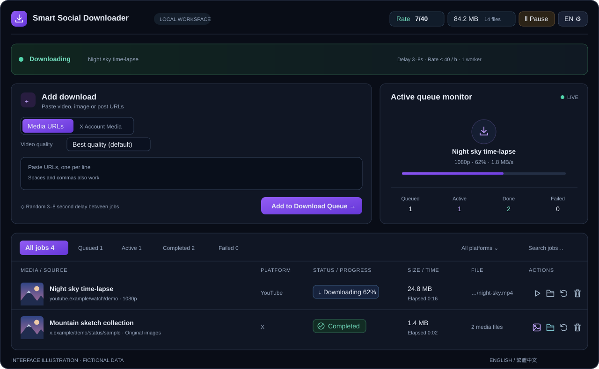

# Smart Social Downloader

English | [繁體中文](docs/README_CN.md)

A local video and image download manager with a browser interface. Paste URLs, queue downloads, and organize media into platform folders. Powered by **yt-dlp**, **gallery-dl** and **FFmpeg**.

**Windows · Python 3.12 · MIT · [Preview 0.1.0-preview.2](https://github.com/Zimkjdv/Smart-Social-Downloader/releases/tag/v0.1.0-preview.2)**



*Interface illustration with fictional accounts, URLs and artwork; no personal download history.*

## Features

- **Videos and images:** multi-platform URL downloads, native HLS/DASH, original-size images where available, and platform/account folders.
- **Quality control:** highest available video quality by default; optional 2160p–144p height limits. Merge streams without re-encoding.
- **Optional JavaScript capture:** a temporary Chrome context can discover dynamic video/audio sources and hand them to the normal download queue. [Enable it](docs/guides/DYNAMIC_CAPTURE.md).
- **X account media:** scan accessible images/videos first, show file totals, verify existing files, and sync missing/new media using your connected X session.
- **Verified duplicate checks:** recognized Pixiv artwork link variants share a stable ID; original files must still match their saved location, size and modification time. Quality/media preferences stay separate. [Identity and legacy compatibility](docs/reference/DOWNLOAD_DEDUP.md#pixiv-artwork-identity-and-legacy-completion-records).
- **Pixiv author works:** OAuth setup, scan-first file totals, original illustrations/manga pages and animation frames, `pixiv/Author name(ID)/` folders, and file-verified incremental sync. [Setup](docs/guides/PIXIV.md) · [Real author acceptance](docs/testing/PIXIV_ACCEPTANCE.md).
- **Queue control:** background serial downloads, 3–8 second delays, configurable hourly quota, per-platform/shared cooldowns, pause, stop and retry.
- **A manageable library:** local thumbnails, file size/time, view/play/open-folder actions, filters, pagination and preserved history.
- **Local operation:** English / Traditional Chinese UI, Windows-encrypted X / Pixiv session storage, environment checks and redacted diagnostic export.

## Quick start

1. Install **Python 3.12** on Windows, then download and extract the versioned source ZIP from the [preview release](https://github.com/Zimkjdv/Smart-Social-Downloader/releases/tag/v0.1.0-preview.2).
2. Run **`setup.bat`** to create `.venv` and install the pinned dependency baseline.
3. Run **`start.bat`**. It starts the service in the background and opens the web interface when ready.
4. Open [http://127.0.0.1:8765](http://127.0.0.1:8765), paste media URLs and click **Add to Download Queue**.

`start.bat` also sets up an unfinished installation. Later starts check the local environment without installing or updating packages. Keep the backend running; refreshing or closing the browser does not stop downloads.

Some sites, including YouTube, need **Node.js 22+ or Deno 2.3+**. Install a runtime if diagnostics requests it, then restart the service. See [installation and troubleshooting](docs/guides/TROUBLESHOOTING.md).

For X login, sign into X in ordinary Chrome, then use **Settings → X sign-in**. If the connector is needed, follow its [one-time installation guide](chrome-extension/README.md). The tool connects an existing session; it does not perform Google/Apple sign-in.

For Pixiv, use **Settings → Pixiv sign-in**, click **Connect Pixiv** and finish sign-in in ordinary Chrome. Connector 1.2.0 returns authorization automatically (install/reload it once); then select **Pixiv author works** and paste an author URL or numeric ID. See the [Pixiv guide](docs/guides/PIXIV.md). Core Windows author download/recovery checks have passed; other authorization and platform cases remain pending.

### Background start and stop (Windows)

- **`start.bat`**: check/install the environment, launch the hidden background service, and open its page. Running it again opens the existing service instead of starting another instance.
- **`stop.bat`**: request a graceful stop, preserve queue state and let download workers shut down. Closing the browser does not stop the background service.
- Startup errors: see **`data/background.log`**. An older foreground instance must be stopped with **Ctrl+C** in its console before switching to background mode.
- For a visible foreground console, use **`.venv\Scripts\python.exe -X utf8 tools\manage.py start`** and stop with Ctrl+C. Docker startup is unchanged.

If another process is using the default port `8765`, choose an available port such as `8766`. If the downloader is already running, stop it with `stop.bat`. Run this command in PowerShell to save the port for your Windows account.

```powershell
[Environment]::SetEnvironmentVariable('SSDL_PORT', '8766', 'User')
```

Run `start.bat` from a new terminal window, then open [http://127.0.0.1:8766](http://127.0.0.1:8766). If you use the Chrome connector, set its **Local connection settings** to the same port.

See [desktop background service](docs/guides/WINDOWS.md) for custom ports, shutdown timeouts and process ownership, and [native acceptance](docs/testing/DESKTOP_ACCEPTANCE.md) for lifecycle checks and their scope.

For shell integrations, `python -m ssdl.desktop_control ensure` starts/attaches without opening a browser and returns versioned JSON; `status` verifies the running instance. See [supervisor contract](docs/reference/DESKTOP_CONTROL.md). After updating an older running service, explicitly stop and restart it to publish the new identity record.

### Optional Windows desktop window

Run **desktop.bat** to install the optional pinned pywebview packages and open the same UI in WebView2. Microsoft Edge WebView2 Runtime is required. Closing the window keeps downloads running; use its confirmed Stop action when it owns the backend, or stop.bat for an existing service. Browser start.bat remains available. This batch entry is the Python source version. D05 also builds an EXE directory bundle and per-user installer with Python/Node/FFmpeg included; clean Windows acceptance remains pending. See [Windows distribution and migration](docs/deployment/WINDOWS_DISTRIBUTION.md). See [desktop guide](docs/guides/WINDOWS.md).

### Chrome connector: first-time setup

Use the ordinary Chrome profile where you sign into X or Pixiv. Keep the downloader running during setup.

1. Obtain the **`chrome-extension`** folder from the extracted project source. Alternatively, click **Download Chrome connector** on the tool's connection page and extract the ZIP first.
2. In Chrome's address bar, enter **`chrome://extensions`**.
3. Enable **Developer mode** in the upper-right corner.
4. Click **Load unpacked** and select the **`chrome-extension` folder containing `manifest.json`**. Select the folder, not the ZIP, `manifest.json` itself or the project root.
5. Confirm that **Smart Social Downloader · X / Pixiv 連接器** is enabled. Approve the requested site permissions if Chrome prompts you.
6. Return to the local connection page and refresh it so it detects the connector.
7. In the downloader, use **Settings → X sign-in** to connect your existing X session, or **Settings → Pixiv sign-in → Connect Pixiv**. Complete any Pixiv sign-in/verification in Chrome; authorization returns automatically without F12 or copying a code.

**Updating an existing installation:** update the files in the originally loaded folder, then click the connector's **Reload** button at `chrome://extensions` and refresh the connection page. Version **1.2.0** adds Pixiv site / `webRequest` permissions; approve them if requested. The extension ID stays the same, so an existing installation does not need to be removed.

**Custom port / Docker:** if the tool uses a port other than `8765`, select that same port under **Local connection settings** in the extension popup before connecting. For Docker, install the connector in **host Chrome** using an extracted host folder. See the [connector guide](chrome-extension/README.md) and [Pixiv guide](docs/guides/PIXIV.md) for permissions and troubleshooting.

## Limits and support

- Platform/extractor support and account access determine what is available. Not every URL can be downloaded; deleted, inaccessible or DRM content may be unavailable.
- “Original-size / best quality” means the files a platform exposes. The uploader's pre-compression original cannot be reconstructed.
- Generic discovery handles static HTML/player data and embedded players; multiple players can require a choice. Optional JavaScript capture needs Playwright and ordinary Chrome; interactive/login-only/DRM transports can remain unsupported.
- Pacing cannot guarantee avoidance of account restrictions. Default quota is 40 started jobs per rolling hour; failures and retries count. Submissions allow up to 30 URLs, with up to 200 job records.
- Windows is the primary supported environment. macOS/Linux, clean-Windows/Chrome pairing and all preview workflows are not fully verified. See [review progress](docs/development/ROADMAP.md).

## Documentation

| Start here | Purpose |
| --- | --- |
| [Documentation index](docs/README.md) | All guides, contracts and evidence by audience |
| [Usage](docs/guides/USAGE.md) · [繁體中文](docs/guides/USAGE_CN.md) | Downloads, settings, login and file actions |
| [Windows](docs/guides/WINDOWS.md) · [Docker](docs/deployment/DOCKER.md) | Launching and deployment |
| [Architecture](docs/reference/ARCHITECTURE.md) · [API](docs/reference/API_CONTRACT.md) | Module responsibilities and shared contracts |
| [Testing](docs/development/TESTING.md) · [Acceptance](docs/testing/README.md) | Repeatable checks and their limits |
| [Maintenance](docs/development/MAINTENANCE.md) · [Roadmap](docs/development/ROADMAP.md) | Releases, dependencies and remaining work |

## Project structure

```text
smart-social-downloader/
├── app.py / *.bat              Source launch and setup
├── ssdl/                       Python backend
├── static/                     Shared browser and desktop UI
├── desktop/                    Windows native shell
├── chrome-extension/           Chrome session connector
├── docs/                       Guides, contracts, tests and historical records
├── tests/                      Regression suites and shared fixtures
├── tools/                      Installation, validation and packaging
├── docker/ / packaging/        Deployment and distribution support
└── data/ / downloads/ / dist/   Local/generated; excluded from source packages
```

`ssdl` abbreviates **Smart Social Downloader** and names the Python package. Runtime data stays relative to the project root; the media destination can be changed in settings. Importing the entry module does not restore login/history or start workers. Each explicit AppContext owns its queue and services. Full module responsibilities and lifecycle are in [Architecture](docs/reference/ARCHITECTURE.md).

## Updates, reporting and releases

The **application version** appears beneath the app name and in Settings → Diagnostics. Engine versions appear separately in environment diagnostics. `update.bat` updates engines; it does not update application source. See [Maintenance](docs/development/MAINTENANCE.md) and [CHANGELOG](docs/history/CHANGELOG.md).

CI Actions use reviewed commit SHAs. Dependabot proposes weekly Actions/Python dependency updates for maintainer review and regression/source-distribution checks. See [dependency maintenance](docs/development/MAINTENANCE.md#dependency-updates-and-action-pins).

The [first dependency review](docs/history/DEPENDENCY_ACCEPTANCE.md) adopts pycryptodomex 3.24.1 and retains the compatible browser pins. After updating source with changed dependency pins, stop the service and run `setup.bat` to apply the reviewed baseline, then restart. Updating source or restarting alone does not install changed packages; `update.bat` explicitly updates within the compatibility ranges.

Maintainers can run `python tools/check_dependency_faults.py --report data/dependency-faults.json` after engine/browser updates. CI and extracted-source acceptance also run this [fault-tracking gate](docs/development/DEPENDENCY_FAULTS.md), recording versions and safe fault categories; new warnings, socket resource leaks or failed transport checks fail acceptance.

Windows CI also checks installation, offline startup/restart, native background start/stop and package update/restore in a fresh extracted source and venv. Maintainers can run `python tools/check_installation.py --browser`; it downloads dependencies into disposable storage. See [acceptance scope](docs/testing/INSTALLATION_ACCEPTANCE.md) for the distinction between batch cleanup, graceful app close and remaining real desktop/X checks.

State saves use an owned background writer with immutable snapshots. Critical changes wait for durable writes without holding the queue lock; failed saves remain visible and can be retried in Diagnostics. Maintainers can reproduce synthetic capture/save/API latency measurements with `python tools/measure_persistence.py`. See [persistence performance](docs/reference/PERSISTENCE_PERFORMANCE.md) for results and limits; the command uses disposable history and does not download media or restore login.

Settings → Diagnostics shows saved history size and warns at 80% of its **64 MiB** limit. Capacity failures preserve the last good records and original media; oversized child messages report a specific error and allow subsequent jobs to continue. These limits apply to JSON metadata, not video/image file sizes. For recovery steps, synthetic account/IPC measurements and `python tools/measure_capacity.py --full-limits`, see [capacity and limits](docs/reference/CAPACITY.md).

The same tab offers SQLite capacity checks, consistent local backups and manual compaction. Pause the queue and wait for active downloads to finish before backup/compaction; compaction first creates a checked backup and retains dedup records and original media. Backups stay under `data/database-backups/` and need additional space. See [database maintenance and recovery](docs/reference/DATABASE_MAINTENANCE.md); indexed file storage remains a future feature in [ROADMAP](docs/development/ROADMAP.md).

After the GitHub repository is published, use the Issue forms for bugs, installation or feature requests. Read [CONTRIBUTING](.github/CONTRIBUTING.md) first and review diagnostics/screenshots before sharing them. Vulnerabilities use the private process in [SECURITY](.github/SECURITY.md).

The versioned source ZIP includes code, docs, public artwork and licenses. Downloaded media, history, cookies and virtual environments stay local. For setup, follow the quick start above. [Preview downloads and SHA-256 checksum](https://github.com/Zimkjdv/Smart-Social-Downloader/releases/tag/v0.1.0-preview.2)

Maintainers can run `python tools/check_source_archive.py` to build, verify and test the extracted source ZIP using the current installed dependencies. See [test fixtures and source acceptance](docs/development/TESTING.md) for package boundaries and commands.

## Planned work

Pending reliability fixes, architecture improvements and release acceptance are tracked in [Roadmap](docs/development/ROADMAP.md). Completed implementation milestones are in [CHANGELOG](docs/history/CHANGELOG.md).

The experimental [Docker deployment](docs/deployment/DOCKER.md) includes Python 3.12/Compose, three persistent volumes, local networking/health checks, [backup/recovery](docs/deployment/DOCKER_STORAGE.md) and [host Chrome login/browser file actions](docs/deployment/DOCKER_LOGIN.md). Linux sessions use memory by default, with optional external-key encrypted persistence. Actual Linux amd64 builds, the [nine-check runtime gate](docs/testing/DOCKER_ACCEPTANCE.md), [14-stage service/storage gate](docs/testing/DOCKER_SERVICE_ACCEPTANCE.md), [15-stage invented-login/media HTTP gate](docs/testing/DOCKER_INTERACTION_ACCEPTANCE.md) and [eight-stage actual host-storage gate](docs/testing/DOCKER_HOST_ACCEPTANCE.md) pass. The optional [seven-stage host Chrome gate](docs/testing/DOCKER_BROWSER_ACCEPTANCE.md) adds actual UI, PNG decoding and H.264 play/seek checks; Linux CI runs the combined `--browser` gate. Another physical host (currently deferred), actual version migrations and human Chrome/login interaction remain on the [roadmap](docs/development/ROADMAP.md#docker-化部署); no prebuilt image is published.

## License

This project's own code and documentation use [MIT](LICENSE). Dependencies retain their own licenses; see [THIRD_PARTY_NOTICES](docs/reference/THIRD_PARTY_NOTICES.md).
