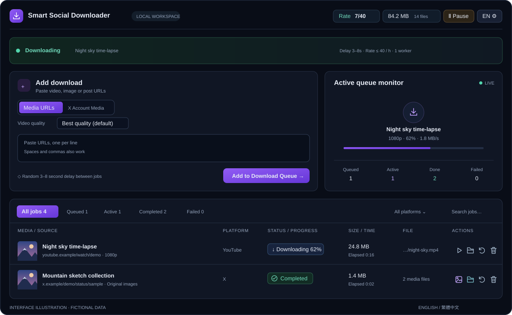

# Smart Social Downloader

[English](README.md) | 繁體中文

在自己電腦執行的影片與圖片下載管理工具。貼上網址即可排隊下載，媒體依平台分類保存。使用 **yt-dlp**、**gallery-dl** 與 **FFmpeg**。

**Windows · Python 3.12 · MIT · 預覽版 0.1.0-preview.2（尚未發布）**



*展示圖使用虛構帳號、網址與插畫，不包含個人下載紀錄。*

## 核心功能

- **影片與圖片下載**：多平台網址、原生 HLS／DASH、可取得的原尺寸圖片，以及平台／帳號資料夾。
- **畫質選擇**：預設最高可用畫質，可選 2160p～144p 高度上限；合併影音串流時不重新編碼。
- **選配 JavaScript 捕捉**：使用臨時 Chrome 工作階段發現動態影音來源，再交給原有下載流程。[啟用方法](docs/DYNAMIC_CAPTURE.md)。
- **X 帳號媒體**：先掃描可存取的圖片與影片並顯示總數，核對原位置檔案，再補抓新增或缺少的內容。
- **背景佇列**：單 worker、3～8 秒延時、可調每小時額度、獨立／共用平台冷卻，以及暫停、停止與重新下載。
- **清單管理**：本機縮圖、SIZE／TIME、播放／查看／開啟資料夾、篩選、分頁及保存紀錄。
- **本機操作**：繁中／英文介面、Windows 加密保存 X 登入、環境診斷與經遮蔽的診斷匯出。

## 快速開始

1. 在 Windows 安裝 **Python 3.12**，下載並解壓專案原始碼。
2. 執行 **`setup.bat`**，建立 `.venv` 並安裝鎖定版本的基準套件。
3. 執行 **`start.bat`**。
4. 在瀏覽器開啟 [http://127.0.0.1:8765](http://127.0.0.1:8765)，貼上媒體網址並按 **加入下載佇列**。

尚未完成安裝時，`start.bat` 會先安裝；後續啟動只檢查本機環境，不安裝或更新套件。保持後端執行，重新整理或關閉網頁不會停止下載。

YouTube 等部分網站需要 **Node.js 22+ 或 Deno 2.3+**。環境診斷提示需要 runtime 時，安裝並重新啟動服務。詳見 [安裝與排錯](docs/TROUBLESHOOTING.md)。

下載需要登入的 X 內容時，先在一般 Chrome 登入 X，再使用 **設定 → X 登入**。如需連接器，依 [首次安裝步驟](chrome-extension/README.md) 載入。工具連接既有登入狀態，不代為執行 Google／Apple 登入。

## 限制與支援範圍

- 可下載內容取決於平台、解析器及帳號存取權限；不能保證任何網址都可下載。已刪除、無法存取或 DRM 內容可能無法取得。
- 「原尺寸／最高畫質」指平台提供的版本，無法還原平台壓縮前的上傳原檔。
- 通用解析支援靜態 HTML、播放器資料及嵌入頁面；多播放器可先選擇再下載。選配動態捕捉需要 Playwright 與一般 Chrome；互動、登入專用或 DRM 傳輸仍可能無法取得。
- 延時與限流不能保證不受平台限制。預設最近 60 分鐘最多啟動 40 個工作，失敗與重試也計入；每次最多 30 個網址，清單最多 200 個工作紀錄。
- 目前優先支援 Windows；macOS／Linux、乾淨 Windows／Chrome 配對及所有預覽版流程尚未完整驗收。未完成工作與驗收進度見 [Roadmap](ROADMAP.md)。

## 詳細文件

| 文件 | 內容 |
| --- | --- |
| [繁體中文操作指南](docs/USAGE_CN.md)／[English usage](docs/USAGE.md) | 設定、畫質、檔案操作、X 同步、限流與 CLI |
| [操作與排錯](docs/TROUBLESHOOTING.md) | 安裝、診斷、本機 API 與登入問題 |
| [Chrome 連接器](chrome-extension/README.md) | 安裝、配對、自訂連接埠及重新載入 |
| [影片畫質](docs/VIDEO_QUALITY.md) · [已下載檔案檢查](docs/DOWNLOAD_DEDUP.md) | 畫質、保存位置與避免重複下載 |
| [JavaScript 捕捉](docs/DYNAMIC_CAPTURE.md) · [測試紀錄](docs/TESTING.md) | 選配安裝、捕捉限制、回歸與瀏覽器驗收 |
| [專案複查](docs/PROJECT_AUDIT.md) | 本輪重現問題、修正與剩餘驗收 |
| [可靠性](docs/RELIABILITY.md) · [效能](docs/PERFORMANCE.md) | 恢復、停止、串流完整性、分頁與快取 |
| [架構](docs/ARCHITECTURE.md) · [P2 實作](docs/P2_COMPLETION.md) | 模組分工、語系 key、播放器選擇與冷卻 |
| [發布與隱私](docs/RELEASE.md) · [維護指南](docs/MAINTENANCE.md) | 原始碼包、版本規則及發布清單 |

首頁及操作指南提供中英文；維護、貢獻與安全回報文件以英文為主。

## 專案結構

```text
smart-social-downloader/
├── app.py                         服務啟動入口
├── setup.bat / start.bat           安裝及啟動
├── update.bat                     主動更新引擎
├── requirements*.txt              更新相容範圍／鎖定基準／選配捕捉
├── README.md / README_CN.md        英文／繁體中文首頁
├── CHANGELOG.md                   應用程式更新紀錄
├── SECURITY.md / CONTRIBUTING.md   私人安全回報／貢獻說明
├── LICENSE / THIRD_PARTY_NOTICES.md
├── ROADMAP.md               未完成工作與驗收進度
├── ssdl/                          Python 後端套件
│   ├── version.py                 唯一應用程式版本來源
│   ├── app.py                     組裝入口
│   ├── app_context.py             具型別的狀態、服務與生命週期
│   ├── media.py                   相容的下載入口
│   ├── media_contracts.py         共用來源識別、路徑與錯誤
│   ├── media_coordinator.py       引擎調度、通用解析與去重
│   ├── media_engines.py           選配引擎與共用設定
│   ├── video_adapter.py          yt-dlp 畫質與原始串流下載
│   ├── gallery_adapter.py        gallery-dl 設定與媒體下載
│   ├── image_adapter.py          圖片原始位元組與保存紀錄
│   ├── x_account_media.py        X 帳號掃描／同步及公開貼文
│   ├── browser_media.py           選配臨時 Chrome 捕捉
│   └── *.py                       API、排程、保存及下載模組
├── static/                        網頁介面、樣式及語系 key
├── chrome-extension/              Chrome X 登入連接器
├── tools/                         安裝、診斷及原始碼打包
├── docs/                          操作、架構與維護文件
│   └── images/dashboard-preview.svg  可公開的虛構介面示意
├── tests/                         本機 fixture 與回歸測試
├── .github/
│   ├── ISSUE_TEMPLATE/            錯誤、安裝、功能及私人聯絡表單
│   ├── pull_request_template.md   修改及驗證摘要
│   └── workflows/                 Windows CI 設定
└── data/ downloads/ .venv/ dist/   本機／生成內容，排除於原始碼包
```

`ssdl` 是 **Smart Social Downloader** 的縮寫，作為 Python 套件名稱。執行資料仍相對於專案根目錄保存，媒體下載位置可在設定中修改。匯入入口模組不會恢復登入／歷史或啟動 worker；每個明確建立的 AppContext 各自擁有佇列與服務。完整模組用途與生命週期見 [架構文件](docs/ARCHITECTURE.md)。

## 更新、回報與發布

**應用程式版本**顯示在頂部名稱下方及設定 → 診斷；引擎版本另列於環境診斷。`update.bat` 更新引擎，不更新應用程式原始碼。詳見 [維護指南](docs/MAINTENANCE.md) 與 [CHANGELOG](CHANGELOG.md)。

GitHub repo 發布後，可使用 Issue 表單回報錯誤、安裝問題或功能建議。分享前先檢視診斷與截圖，避免個人資料外洩；流程見 [CONTRIBUTING](CONTRIBUTING.md)。漏洞請依 [SECURITY](SECURITY.md) 使用私人回報方式。

原始碼 ZIP 包含程式、文件、公開展示圖及授權，排除下載檔案、歷史、Cookie 與 Python 環境。檔名包含應用程式版本；它不是可執行安裝程式。原始碼 repo 為 [Zimkjdv/Smart-Social-Downloader](https://github.com/Zimkjdv/Smart-Social-Downloader)。啟用 GitHub 私人漏洞回報及發布有 tag 的預覽 Release 仍待進行。

## 未來規劃

待修問題、架構改善與發布驗收統一列於 [Roadmap](ROADMAP.md)，已完成里程碑見 [CHANGELOG](CHANGELOG.md)。

**Docker 化部署**已加入[未來清單](ROADMAP.md#docker-化部署)：Python 3.12 映像、Compose、資料／媒體持久化、健康檢查及容器登入保存。此項尚未實作。

## 授權

專案自有程式碼與文件使用 [MIT](LICENSE)，第三方套件保留各自授權，見 [THIRD_PARTY_NOTICES](THIRD_PARTY_NOTICES.md)。
