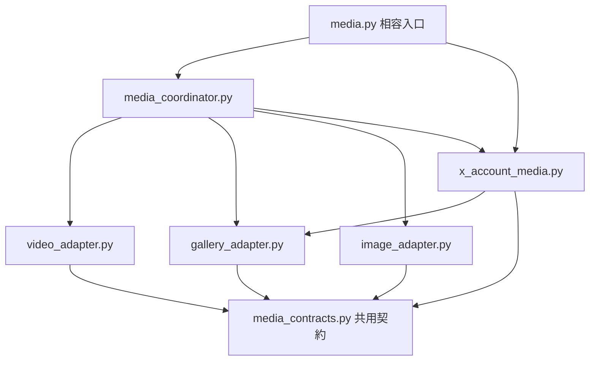

# 專案結構與維護

D03 新增選配 [pywebview／WebView2 來源版本](DESKTOP_GUI.md)：`desktop/pywebview_app.py` 管理 native frame、原生動作及受限 WebView2 事件，`static/desktop_pywebview.js` 處理 bridge 就緒／取消／期限；組裝入口明確選 Adapter，業務 controller 繼續使用 HTTP。預設瀏覽器入口不變；一般 Chrome 承接授權，專用 `data/webview2` 保存 UI 偏好。安裝包與完整 D04 矩陣尚未進行。

D02 將 `ensure_backend()` 與 `open_page()` 分開，新增 [Supervisor／JSON 控制契約](DESKTOP_CONTROL.md) 及受本機來源保護的 `/api/identity`。啟動／附接核對控制鎖、執行個體與版本；外殼僅以執行個體專屬事件停止自己啟動的後端。`WindowSession` 管理同 scope 的單視窗／喚回事件，關閉它不停止背景工作。GUI 套件仍不是後端依賴。

D01 已加入 [共用 HTTP／桌面契約](API_CONTRACT.md)：`static/desktop.js` 集中 Browser Adapter 的外部開頁、彈窗預留、診斷下載及剪貼簿，由 `app.js` 注入 controller。業務功能仍使用 `static/api.js`；`ssdl/platform_actions.py` 承接驗證後的 Windows 開檔分派，路徑與來源檢查留在 HTTP。pywebview Adapter／服務生命週期依 [Roadmap](../ROADMAP.md) 後續實作。

後端模組集中到 `ssdl/`。根目錄 `app.py` 是簡單入口，`python app.py`、`start.bat` 及既有瀏覽器網址仍可使用。

`ssdl` 是 **Smart Social Downloader** 的縮寫，作為 Python 套件名稱，方便使用 `from ssdl import media` 等匯入。它不代表下載媒體的分類資料夾；平台分類仍使用 `youtube/`、`twitter/` 等名稱。中英文 README 均提供目錄結構及用途。

這份文件描述目前結構。N06 的 AppContext、初始化生命週期、後端下載引擎及前端控制器拆分均已實作；N07 的 [保存量測與 writer](PERSISTENCE_PERFORMANCE.md)、[容量邊界](CAPACITY.md) 及 [SQLite 維護／索引評估](DATABASE_MAINTENANCE.md) 已完成。N08 的 [共用測試 fixture 與來源包驗收](SOURCE_TESTING.md) 已實作；後續索引實作與環境驗收見 [Roadmap](../ROADMAP.md)。匯入 `ssdl.app` 不會建立管理器、恢復登入／歷史或啟動 HTTP／worker。

```text
smart-social-downloader/
├── app.py                    # 啟動入口
├── setup.bat                 # 首次安裝／恢復基準依賴
├── start.bat                 # 背景啟動並開啟網頁
├── stop.bat                  # 正常停止專屬背景服務
├── update.bat                # 主動更新下載引擎
├── Dockerfile / compose.yaml # 實驗性 Linux amd64 部署來源
├── compose.login.yaml        # 選配的獨立登入金鑰 secret 掛載
├── .dockerignore             # 預設排除、明確允許的 build context
├── docker/
│   ├── entrypoint.py         # 容器監聽與 SIGTERM 清理入口
│   ├── runtime.py            # 固定掛載、寫入檢查與儲存區互斥鎖
│   ├── storage.py            # 停機完整備份、校驗及空 volume 還原
│   ├── healthcheck.py        # 有界、無 proxy 的本機健康探測
│   ├── session_key.py        # 不顯示、不覆寫的外部金鑰建立
│   └── debian.sources        # 固定且驗簽的 Debian 套件快照
├── requirements.txt          # 引擎更新的相容範圍
├── requirements.lock.txt     # 發布基準依賴
├── requirements-browser.txt  # 選配 Playwright 鎖定版本
├── README.md                 # 英文首頁
├── README_CN.md              # 繁體中文說明
├── CHANGELOG.md              # 應用程式更新紀錄
├── SECURITY.md               # 私人安全回報政策
├── CONTRIBUTING.md           # 貢獻與回報說明
├── ROADMAP.md         # 未完成工作與最新審查
├── LICENSE
├── THIRD_PARTY_NOTICES.md
├── ssdl/                     # Python 後端套件
│   ├── version.py            # 唯一應用程式版本來源
│   ├── app.py                # create_app factory、組裝與啟動入口
│   ├── desktop_service.py  Windows background ownership / graceful stop
│   ├── app_context.py        # AppState、實例擁有的服務及 start／close
│   ├── http_api.py           # HTTP 路由與本機來源檢查
│   ├── http_server.py        # HTTP 連線上限、讀取期限與 socket 清理
│   ├── scheduler.py          # 排程、額度及生命週期
│   ├── state_repository.py   # 狀態載入、遷移及保存
│   ├── media_selection.py    # 受限播放器選擇
│   ├── job_views.py          # 工作摘要、分頁與檔案明細
│   ├── config.py             # 共用 SSDL_PORT 驗證
│   ├── environment.py        # 啟動／介面共用本機診斷
│   ├── diagnostics.py        # 錯誤／提醒共用遮蔽
│   ├── persistence.py        # schema、原子保存及有效備份恢復
│   ├── state_writer.py       # 不可變快照、合併更新、generation 落盤確認
│   ├── database_maintenance.py # 固定 SQLite 目錄、診斷／備份／整理及生命週期
│   ├── media_manifest.py     # 一般媒體來源及完成檔案核對
│   ├── job_runtime.py        # 下載子程序監督、停止及無進度期限
│   ├── job_runner.py         # 下載子程序與匿名管線通訊
│   ├── ipc.py                # 16 MiB frame／64 MiB 訊息分段與驗證
│   ├── json_budget.py        # 寫入前限制 UTF-8 JSON 位元組；共用保存／IPC
│   ├── process_group.py      # 所屬程序樹／合併工具清理
│   ├── network.py            # 公開 HTTP 目標及實際連線檢查
│   ├── media.py              # 相容的下載入口，明確匯出各模組函式
│   ├── media_contracts.py    # 來源 ID、路徑、錯誤及 paced HTTP 共用契約
│   ├── media_engines.py      # 選配引擎、FFmpeg 探測及共用完整性設定
│   ├── media_coordinator.py  # 引擎調度、通用解析、完整來源 manifest
│   ├── video_adapter.py      # yt-dlp、畫質／播放器選擇及串流下載
│   ├── gallery_adapter.py    # gallery-dl 設定、節流與檔案進度
│   ├── image_adapter.py      # 原始圖片位元組及 ImageHistory
│   ├── x_account_media.py    # X 帳號掃描計畫／同步及公開貼文
│   ├── profiles.py  作者網址、平台模式與標準化
│   ├── pixiv_auth.py  Pixiv PKCE 授權及加密登入保存
│   ├── pixiv_auth_exchange.py  隔離、固定端點的 Token 交換
│   ├── pixiv_profiles.py  作者原圖掃描與核對後增量補抓
│   ├── pixiv_paths.py  共用作者名／ID 資料夾及跨平台安全命名
│   ├── video_quality.py       # 來源尺寸辨識及畫質顯示
│   ├── web_media.py          # 通用 HTML／播放器媒體發現
│   ├── browser_media.py      # 選配臨時 Chrome／受檢查傳輸
│   ├── x_auth.py             # X 登入連接與加密保存
│   ├── session_storage.py    # DPAPI／外部金鑰 AES-GCM／記憶體保存
│   ├── local_media.py        # 限定工作檔案的 GET／HEAD／單段 Range
│   ├── x_profiles.py         # 帳號網址及媒體保存紀錄
│   ├── image_history.py      # 圖片直連保存紀錄
│   ├── request_policy.py     # 延時、節流及冷卻
│   ├── download_stats.py     # 容量統計
│   └── thumbnails.py         # 本機縮圖
├── static/                   # HTML、CSS、JavaScript 與語系
│   ├── locales.js            # 固定中英文 key
│   ├── ui_state.js           # 共用頁面狀態
│   ├── job_presentation.js   # 工作格式與列表呈現
│   ├── x_login.js            # X 登入操作
│   ├── media_selection.js    # 播放器選擇
│   ├── ui_accessibility.js   # 彈窗焦點與鍵盤
│   ├── ui_accessibility.css  # 焦點與窄視窗
│   ├── api.js                # 請求期限、JSON 與回應結構驗證
│   ├── app.js                # 組裝、已驗證 snapshot 發布與刷新
│   ├── settings_controller.js # 設定草稿、分頁及 Rate 確認
│   ├── diagnostics_controller.js # 診斷、健康、容量與快取操作
│   ├── database_controller.js # SQLite 報告版本、背景狀態輪詢及整理確認
│   ├── jobs_controller.js    # 清單、篩選／分頁及檔案選擇
│   ├── controller_lifecycle.js # 控制器事件、計時器及清理
│   ├── job_rows.js           # 資料列保留與變動欄位更新
│   ├── settings.css          # 設定分頁、固定導覽與內容捲動
│   └── i18n.js               # 繁中／英文訊息
├── chrome-extension/         # Chrome X 本機連接器
├── tools/                    # 環境管理、量測與原始碼打包
│   ├── package_source.py      # 有界來源樹與允許清單 ZIP
│   ├── check_source_archive.py # 解壓後匯入檢查與完整回歸
│   ├── check_workflows.py      # 已審查 Action 來源與完整 SHA 的離線政策
│   ├── check_installation.py   # 新來源／venv 的安裝、啟動與更新恢復驗收
│   ├── check_desktop.py        # 原生背景啟停、佇列恢復與專案隔離驗收
│   ├── check_chrome_pairing.py    一般 Chrome／原生 DPAPI 隔離配對驗收
│   ├── check_dependency_faults.py # 有界警告／傳輸觀察與維護回歸門檻
│   ├── check_docker.py       # 隔離來源、context 允許清單、映像與 runtime 驗收
│   ├── docker_runtime_probe.py # 合成影音及 Node provider，經 stdin 傳入容器
│   ├── docker_service_acceptance.py # 真正 Compose／volume／備份／連線隔離驗收
│   ├── docker_storage_probe.py # 需 receipt 的合成資料與還原中斷注入
│   ├── docker_interaction_acceptance.py # 真正容器登入／重啟及 HTTP 媒體驗收
│   ├── docker_interaction_probe.py # 僅供隔離 fixture 的合成金鑰／登入／媒體操作
│   ├── docker_host_acceptance.py # 私有主機資料夾、檔案型 secret 與還原登入驗收
│   ├── docker_host_probe.py    # receipt 限定的 bind 權限／歸還擁有者與備份檢查
│   ├── docker_browser_acceptance.py # 主機 Chrome 檔案 UI／鍵盤與實際圖片／影片解碼
│   ├── docker_pixiv_acceptance.py # 非 root、斷網的 Linux Pixiv 目錄／恢復／授權／識別驗收
│   ├── measure_persistence.py # 隔離合成歷史保存／API 延遲量測
│   ├── measure_capacity.py    # 合成帳號掃描、IPC 及保存容量邊界
│   └── measure_hashing.py     # 合成內容雜湊評估，未接入下載流程
├── docs/                     # 使用、發布、去重及架構說明
├── tests/                    # 本機 API、下載、串流及發布測試
│   ├── __init__.py            # 明確測試套件，discovery 以專案根為 top level
│   ├── helpers/app.py         # 共用隔離實例、覆寫及暫存資料清理
│   ├── helpers/docker.py      # 共用假 Docker CLI；不作為真實容器驗收證據
│   ├── helpers/install_runner.py # receipt 閘門、批次子程序及正常關閉 fixture
│   └── helpers/console_runner.py # 獨立隱藏控制台、真正 Ctrl+C 及合成下載程序
├── .github/workflows/        # Windows CI 與 Linux Docker runtime／服務驗收
├── data/                     # 本機歷史、設定、登入及快取，排除 Git
├── downloads/                # 預設下載檔，排除 Git
├── .venv/                    # 本機 Python 環境，排除 Git
└── dist/                     # 產生的發布 ZIP，排除 Git
```

## 路徑與匯入規則

- `ssdl.app.ROOT` 固定指向專案根目錄，不取決於呼叫時的工作目錄。`create_app()` 沿用此預設根目錄；測試可明確傳入隔離 root。既有 `data/`、下載位置及 Chrome 連接器位置保持一致。
- 後端模組採套件內相對匯入；測試使用 `from ssdl import media` 等明確匯入。
- 啟動入口只呼叫 `ssdl.app.main()`；匯入模組不會自動開啟 HTTP 服務或啟動下載 worker。
- `main()` 的 `bind_host` 預設仍為 `127.0.0.1`；僅 `docker/entrypoint.py` 明確傳入容器內的 `0.0.0.0`，Compose 對主機發布仍限 loopback。容器入口把 SIGTERM 導向既有 KeyboardInterrupt／context manager 清理，未另建排程或保存邏輯。容器的 `/app/data`、`/app/cache`、`/downloads` 分別掛載，原生縮圖位置保持相容；容器下載位置及保存的 output root 限於 `/downloads`。入口及離線儲存工具共用 volume 互斥鎖，主程式關閉後才釋放。實際 runtime／本機 Compose 儲存與連線驗收已通過，Linux 登入真實配對仍待完成，見 [Docker 部署](DOCKER.md)、[服務驗收](DOCKER_SERVICE_ACCEPTANCE.md)及[儲存回復](DOCKER_STORAGE.md)。
- `/api/health` 沿用讀取 API 的 Host／Origin 檢查，僅取得生命週期、worker、保存與快取環境診斷的布林摘要。它不產生完整工作 snapshot、不重跑診斷、不包含路徑或登入資訊。容器探測限 loopback、socket 3 秒及回應 2 KiB，Docker 每 30 秒執行；故障狀態不等同容器程序已退出。
- `XAuthManager` 接受登入保存實作，透過 `SessionStorage` 集中 DPAPI／AES-GCM／記憶體行為；status 僅傳回模式與可否保存，不回傳金鑰或 Cookie。容器 connect 的配對網址僅屬該次明確回應，前端不把票證放進正常 snapshot／歷史；取消操作淘汰未完成回應。Chrome 擴充功能仍只向使用者選定的 loopback port 傳送 X Cookie。secret 外掛及回復見 [Docker 登入](DOCKER_LOGIN.md)。
- `local_media.py` 只讀取 job/index/精確 filename 所指的普通媒體檔；Linux 使用目錄描述符及 no-follow 開啟，四個讀取名額及 64 KiB 區塊不占用 queue lock。Host／Origin 仍在查詢工作前檢查，媒體 query 不寫入 request log。Windows UI 沿用桌面操作，容器以瀏覽器檢視及既有分頁檔案清單替代主機檔案總管。
- `tools/manage.py` 檢查／安裝第三方環境，不讀取正式登入 Cookie 或下載歷史。
- `ssdl/environment.py` 共用於命令列與介面；服務啟動時在獨立執行緒檢查，API 輪詢只讀快取，使用者按「重新檢查」才啟動下一次診斷。外部命令各有逾時，不占用下載 worker。
- `static/api.js` 共用於主介面與 Chrome 連接頁，檢查 JSON 格式與各路由必要欄位；主介面請求期限為 15 秒。只有有效回應會取代主介面的狀態快取，未確認的寫入不自動重送。
- `http_server.py` 限制同時處理 32 條連線；`http_api.py` 使用 BufferedReader／DeadlineReader，標頭與 body 共用 10 秒絕對期限，零碎資料不重設時限。過載先回覆 503，不建立新 handler 執行緒；socket 寫入期限 5 秒，斷線／shutdown 回收服務所屬連線。讀取期限不限制背景下載總耗時，也不承諾 API 內部磁碟操作的總耗時。
- API 狀態在鎖內產生 `state_instance`／`state_sequence`，供介面忽略較舊及已退役服務的回應。服務重啟使用新的實例 ID；序號不保存至紀錄，也不是授權票證。
- Chrome 連接器只接受擴充功能視窗明確選定的本機連接埠，網頁不能更改接收登入資料的目標。設定方式見 [操作與排錯](TROUBLESHOOTING.md)。
- 原始碼打包器使用允許清單；新增來源檔或文件時須確認已被納入。私人檔不應放在原始碼目錄。

## 維護驗證

狀態介面使用後端分頁與全域摘要，按需讀取完整檔案／診斷；資料列依 ID 保留。容量索引與縮圖快取維護獨立於清單呈現，原始媒體不由快取清理刪除。API、量測與限制見 [PERFORMANCE.md](PERFORMANCE.md)。

```powershell
.\.venv\Scripts\python.exe -m unittest discover -s tests -t . -v
node --test tests/frontend.test.cjs
.\.venv\Scripts\python.exe tools/package_source.py --check
```

測試使用暫存資料夾與本機 HTTP fixture，不需要 X 登入或真實平台下載。API 測試明確建立獨立 AppContext，不須為了匯入 app 預先 mock 登入恢復。

共用支援放在 `tests/helpers/`，不借用其他測試類別的 setUp。來源打包只遞迴明確的 Python／測試邊界，拒絕連結與 Windows reparse 目錄，排除 runtime 目錄；CI 在 checkout 及來源 ZIP 解壓後各執行完整回歸。詳細政策與限制見 [SOURCE_TESTING](SOURCE_TESTING.md)。

已拆出共用設定、環境診斷、保存、manifest、程序監督、網路政策、遮蔽及瀏覽器 API 客戶端。`ssdl/app.py` 的 HTTP 路由、排程與保存已拆出獨立元件；`ssdl/media.py` 現在只保留相容入口，下載實作的責任邊界如下。

## 下載引擎與協調邊界（N06，2026-10-13）



- `media.py` 明確匯出既有函式與錯誤類型，讓 app／job_runner／scheduler 的呼叫方式保持相容。各實作模組直接匯入共用契約，不反向匯入 media facade，不以動態 module proxy 或複製函式全域來維持耦合。
- `media_contracts.py` 集中 `DownloadError`／診斷、source_key、X 貼文／圖片身份、平台資料夾、原保存位置核對與 paced_urlopen。所有 adapter 使用同一個錯誤類型及來源規則；畫質／播放器選擇仍由既有 video_quality／media_selection 提供。
- `media_engines.py` 集中下載引擎的選配匯入、版本、FFmpeg 路徑與串流缺片判定設定。影片及 gallery-dl 委派 yt-dlp 都沿用相同 STREAM_INTEGRITY_OPTIONS，沒有另外複製缺片政策。
- `media_coordinator.py` 負責完整來源 manifest、經核對舊紀錄的遷移、引擎選擇及靜態／動態通用解析。只在適合的錯誤下回退；已有部分檔案、限流及不安全來源錯誤不因拆檔而繼續嘗試其他引擎。
- `gallery_adapter.GALLERY_LOCK` 保護 gallery-dl 的程序全域設定。一般調度與 X 帳號同步共用此鎖；帳號同步先掃描完整計畫，再核對／下載缺少的檔案。直接圖片、影片及公開 X 媒體保留原有命名與進度／回傳格式。
- adapter 與共用 HTTP helper 從 request_policy 模組取得當前 POLICY，避免拆檔時把舊物件綁死。job_runner 建立 RemotePolicy 後，request_policy 與 web_media 使用同一個父程序 RPC 節流／冷卻服務；子程序及 socket 安全邊界保持不變。
- facade 的第三方 library aliases 保留用於既有診斷。維護測試應在實作責任所在的 adapter／coordinator 設定測試替身，不能依賴改寫 facade 別名來改變其他模組的函式全域。

## 工作與資料邊界

HTTP 服務保留佇列、Rate、冷卻、設定及狀態；一個排程 worker 依序啟動 `python -m ssdl.job_runner`。子程序透過匿名管線傳回進度／結果，並向父程序請求 pacing／checkpoint。Cookie 只透過此管線交付，不放進命令列或紀錄。

Windows Job Object 在傳入工作前綁定子程序，其啟動的 FFmpeg／JS helper 由同一組管理。取消、無進度逾時或例外結束只清理此組；排程等待不受無進度時計限制。HTTP 網路 patch 只存在下載子程序，伺服器仍可接受 loopback API。

狀態與有效備份由 `StateStore` 處理，來源完成紀錄使用 SQLite manifest；X 帳號仍使用逐篇 archive。診斷輸出共用遮蔽器且匯出省略歷史網址／檔案路徑。詳細恢復與傳輸限制見 [RELIABILITY.md](RELIABILITY.md)。

歷史候選須先完成離線語法驗證、工作／佇列正規化及設定／冷卻重建，才在 condition 內交換所有狀態。主檔正規化失敗也會嘗試有效備份；損壞輸入另行保留，沒有可恢復候選時阻止自動覆寫。

排程只傳入相同來源／畫質／播放器／保存位置的成功紀錄；X 帳號同步只帶該作者或作者未知的 `i/status` 單篇歷史。`ipc.py` 使用 UTF-8 binary JSON，正常小訊息單 frame、大訊息以 256 KiB 原始資料分段；單 frame 上限 16 MiB，重組後單訊息上限 64 MiB。輸入、RPC、進度、結果與錯誤共用同一協定，容量超限與錯序／中斷分別回報，取消仍由父程序監督。

## P2 模組邊界（2026-10-11）

後端元件明確注入具型別的 AppContext，不再以 `sys.modules` 注入 app 模組，也不反向匯入入口。AppState 明列佇列、Rate、設定及 worker 狀態；API／scheduler／repository 共用同一實例的狀態與鎖。前端將狀態、列表呈現、X 登入、播放器選擇分離，固定語系 key 放在 `static/locales.js`，焦點管理放在 `ui_accessibility.js`。仍是漸進拆分，沒有切換框架。完整規則與驗收狀態見 [P2_COMPLETION.md](P2_COMPLETION.md)。

## 前端控制器邊界（N06，2026-10-13）

`app.js` 組裝設定、診斷與清單控制器，保留快照順序／實例判定、未確認寫入後的讀取核對、30 秒閒置／2 秒活動刷新及新增網址表單。原先 966 行縮為約 390 行；職責比行數重要，雙語資料仍保留於 locales.js。

- factory 透過 `create(dependencies)` 接收 DOM、共用 state、語系／格式函式、API、最新 snapshot getter 及 render／refresh 回呼。載入模組只公開 factory，不存取 DOM 或 API；私有忙碌旗標、對話框 epoch、設定分頁與診斷快取留在各實例。原 API client、keyed row rendering、i18n、X 登入、播放器選擇及焦點模組保留。
- settings_controller 管理草稿、分頁／鍵盤／返回焦點、保存及 Rate 確認。輪詢／語言切換不覆蓋未儲存欄位；重複保存被阻擋。關閉／重開設定會更新 epoch，較晚的開啟／保存回應及舊 auto-close 不會干擾另一輪視窗。
- diagnostics_controller 管理環境檢查與翻譯快取、保存／worker 健康、容量重掃、縮圖清理、診斷匯出與 object URL 回收。jobs_controller 管理列操作、篩選／搜尋 debounce／分頁、錯誤／提醒及每批最多 100 個檔案的選擇；file index 與 filename 一起送出，較晚彈窗回應受 epoch／生命週期保護。
- diagnostics_controller 擁有 database_controller 的 init／dispose。後者負責 SQLite 確認視窗、單一狀態輪詢與 instance／revision 防舊回應；未確認不提交整理，未知寫入結果以讀取校正，不重送操作。
- controller_lifecycle 擁有靜態 listener 與 timer。init 可重複而不增加 listener；dispose 會移除 listener、取消 timer 與回收匯出 URL，已 dispose 的控制器不可再次 init。動態檔案按鈕隨清單 DOM 回收，不為追蹤事件而永久持有它們。
- dispose 不重送或撤回已送出的 mutation；寫入可能已在後端生效，較晚回應不再發布至已清理的控制器。頁面離開時停止刷新與控制器；進入瀏覽器返回快取時保留實例，避免返回後操作失效。
- HTML 明列既有模組、lifecycle、database／diagnostics／jobs／settings factory 與 app 的載入順序。沒有新增框架、bundler 或 npm 依賴；node 測試與真實 Chrome 驗收涵蓋設定草稿、焦點、分頁、Rate、SQLite 整理確認及檔案選擇。

## AppContext 與生命週期（N06）

- `create_app(root, **services)` 明確建立一個 AppContext。建構時只配置記憶體與服務物件，不讀取歷史／登入檔、不開 listener、不啟動背景執行緒；可注入保存、登入、診斷、容量、縮圖及 request policy 的實作。每個實例具有獨立 Handler、鎖、condition、佇列、保存位置與服務；沒有共用 app 模組的可變全域。
- `main()` 先綁定 HTTP port，成功後才呼叫 `start()`：完整恢復歷史與 pacing，再恢復 X 登入、刷新診斷並啟動 writer／單一下載 worker。恢復成功後的正規化保存也可啟動 writer；明確呼叫保存可在未 start 的隔離實例啟動它。重複 start 不會再次恢復或啟動 worker；僅建構或綁定失敗不啟動 writer、不保存歷史。
- `AppContext.condition` 使用同一把 RLock，保護 AppState 與不可變快照擷取；序列化、遮蔽、驗證、fsync／備份寫入在專用 writer 執行，不持有佇列鎖。關鍵變更回傳 generation，呼叫者在鎖外等待保存；新快照可合併尚未寫入的舊進度，但保留全部最新狀態。repository 仍先重建完整候選 AppState／policy，再於 condition 內交換，保護損壞主檔及有效備份。
- writer 最多持有一份正在保存及一份待保存快照。帳號貼文／掃描進度及初始延時 checkpoint 的等待期限固定為首份待保存快照後 0.5 秒，後續 checkpoint 不延後；關鍵變更立即要求保存。磁碟寫入時間另計，完成／失敗結果、Rate 收費、設定／加入／暫停／停止及手動重存均等待 generation。`StateStore.status()` 用獨立短鎖，避免狀態讀取又等待 writer 的磁碟鎖。
- HTTP 服務先關閉 listener／所屬連線。`close()` 拒絕新及已受理但尚未進入變更區的寫入，發出 shutdown、停止登入配對、取消並 join SQLite 維護、等待下載 worker，關閉縮圖／容量／診斷，擷取最後佇列快照，再 flush／join writer。登入 callback 在 shutdown 後不會新增重試。失敗快照保留於記憶體且不持續忙重試；新提交或關閉 flush 可再嘗試，失敗不能回報成已落盤。

SQLite 維護每個 AppContext 各自擁有服務／執行緒／取消狀態；建構與 status 不做 SQLite I/O。HTTP 在 condition 下驗證暫停／無 active，並原子設定維護 busy；scheduler 在同一 condition 下檢查維護 fence，再選取工作。SQLite 作業不持有 queue condition；status 只持有服務短鎖。固定三個檔名目錄同時供 scheduler 子程序參數與維護使用。整理只用 VACUUM，先完成 SQLite backup／檢查／flush／整組發布；讀寫期限、WAL、恢復及索引取捨見 [資料庫維護](DATABASE_MAINTENANCE.md)。
- 登入、縮圖、容量、診斷的 join 期限仍為 8／5／5／15 秒。下載 worker 及 writer 關閉會等待所屬工作／保存完成，不以原先的 10 秒 worker join 提早返回而遺失最後狀態；阻塞的原生檔案系統操作仍可能延長關閉，沒有新增磁碟 I/O 硬期限。這不取代下載子程序的監督與清理。跨程序共寫同一 root 仍不支援。
- close 可重複呼叫；已關閉的 context 不可重新 start，需建立新實例。關閉未啟動的 context 不會讀寫歷史／登入檔；關閉其中一個實例不會停止另一個。

## 發布文件與版本

`ssdl/version.py` 提供 `__version__`，由執行中後端輸出至 API 的 `app_version`，前端據此顯示，並供 CLI、診斷匯出及 ZIP 名稱使用。既有 `version` API 欄位仍指 yt-dlp，以維持相容性；引擎、Chrome manifest 及保存 schema 的版本獨立維護。

README 是中英文精簡首頁；完整操作移至 `docs/USAGE.md`、`docs/USAGE_CN.md`。`docs/MAINTENANCE.md` 定義發布流程，`docs/images/dashboard-preview.svg` 為虛構公開示意；`.github/ISSUE_TEMPLATE/` 與 `.github/pull_request_template.md` 定義回報與 PR 內容。原始碼包以允許清單納入這些檔案，排除 runtime 資料。

`.github/dependabot.yml` 提出每週 Actions／Python 依賴更新 PR。工作流程只直接使用已審查的官方 Actions，固定完整 SHA 並保留版本註解；`tools/check_workflows.py` 對明確區塊式 `uses:` 做離線來源／SHA 語法檢查。它不取代 YAML 驗證、上游 commit 查核或漏洞掃描；更新／回歸／恢復規則見 [維護文件](MAINTENANCE.md#dependency-updates-and-action-pins)。

同一 workflow 的 `install-windows` job 在新來源／新 venv 呼叫安裝驗收工具。其 base Python 閘門先加入所屬 Job Object 才啟動 venv redirector／批次／pip 子程序；控制 receipt 只寫入合成副本。環境命令以 DEVNULL 隔離 stdin，避免繼承控制管線。實際批次強制清理與 installed AppContext 正常關閉分別驗證，完整邊界見 [安裝驗收](INSTALLATION_ACCEPTANCE.md)。

控制台驗收在 base 閘門建立獨立隱藏 console，確認成員後啟動 installed entry。只以合成管線 worker 替代媒體傳輸，實際 entry、HTTP、排程、程序管理、writer 與服務關閉均保留。真正 CTRL_C_EVENT 後先核對正常退出、關閉紀錄、程序 handle 與恢復狀態，再容許 outer Job Object 作失敗清理；詳見 [控制台驗收](CONSOLE_ACCEPTANCE.md)。
