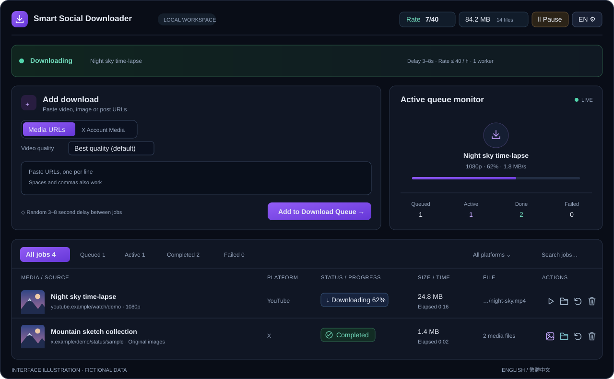

# Smart Social Downloader

[English](../README.md) | 繁體中文

在自己電腦執行的影片與圖片下載管理工具。貼上網址即可排隊下載，媒體依平台分類保存。使用 **yt-dlp**、**gallery-dl** 與 **FFmpeg**。

**Windows · Python 3.12 · MIT · [預覽版 0.1.0-preview.2](https://github.com/Zimkjdv/Smart-Social-Downloader/releases/tag/v0.1.0-preview.2)**



*展示圖使用虛構帳號、網址與插畫，不包含個人下載紀錄。*

## 核心功能

- **影片與圖片下載**：多平台網址、原生 HLS／DASH、可取得的原尺寸圖片，以及平台／帳號資料夾。
- **畫質選擇**：預設最高可用畫質，可選 2160p～144p 高度上限；合併影音串流時不重新編碼。
- **選配 JavaScript 捕捉**：使用臨時 Chrome 工作階段發現動態影音來源，再交給原有下載流程。[啟用方法](guides/DYNAMIC_CAPTURE.md)。
- **X 帳號媒體**：先掃描可存取的圖片與影片並顯示總數，核對原位置檔案，再補抓新增或缺少的內容。
- **檔案核對去重**：已確認的 Pixiv 單篇作品網址變體共用穩定 ID；仍核對原位置、檔案大小與修改時間，畫質／媒體選取分開。[來源識別與舊紀錄相容](reference/DOWNLOAD_DEDUP.md#pixiv-artwork-identity-and-legacy-completion-records)。
- **Pixiv 作者作品**：OAuth 登入設定、先掃描總數、插畫／漫畫原圖與動圖原始影格、`pixiv/作者名(ID)/` 資料夾，以及核對檔案後的增量補抓。[操作說明](guides/PIXIV.md) · [實際作者驗收](testing/PIXIV_ACCEPTANCE.md)。
- **背景佇列**：單 worker、3～8 秒延時、可調每小時額度、獨立／共用平台冷卻，以及暫停、停止與重新下載。
- **清單管理**：本機縮圖、SIZE／TIME、播放／查看／開啟資料夾、篩選、分頁及保存紀錄。
- **本機操作**：繁中／英文介面、Windows 加密保存 X／Pixiv 登入、環境診斷與經遮蔽的診斷匯出。

## 快速開始

1. 在 Windows 安裝 **Python 3.12**，從[預覽版頁面](https://github.com/Zimkjdv/Smart-Social-Downloader/releases/tag/v0.1.0-preview.2)下載有版本標記的原始碼 ZIP 並解壓。
2. 執行 **`setup.bat`**，建立 `.venv` 並安裝鎖定版本的基準套件。
3. 執行 **`start.bat`**，服務會在背景運行，就緒後自動開啟網頁。
4. 在瀏覽器開啟 [http://127.0.0.1:8765](http://127.0.0.1:8765)，貼上媒體網址並按 **加入下載佇列**。

尚未完成安裝時，`start.bat` 會先安裝；後續啟動只檢查本機環境，不安裝或更新套件。保持後端執行，重新整理或關閉網頁不會停止下載。

YouTube 等部分網站需要 **Node.js 22+ 或 Deno 2.3+**。環境診斷提示需要 runtime 時，安裝並重新啟動服務。詳見 [安裝與排錯](guides/TROUBLESHOOTING.md)。

下載需要登入的 X 內容時，先在一般 Chrome 登入 X，再使用 **設定 → X 登入**。如需連接器，依 [首次安裝步驟](../chrome-extension/README.md) 載入。工具連接既有登入狀態，不代為執行 Google／Apple 登入。

Pixiv 請使用 **設定 → Pixiv 登入** 按「一鍵連接 Pixiv」，在一般 Chrome 完成登入後自動連接。首次需載入／更新並重新載入 1.2.0 連接器；再選 **Pixiv 作者作品** 貼上作者網址或數字 ID。詳見 [Pixiv 說明](guides/PIXIV.md)；Windows 作者下載／恢復主流程已通過實際驗收，其他授權與平台情境仍待完成。

### Windows 背景啟動與停止

- **`start.bat`**：檢查／安裝環境後，在背景啟動並自動開啟網頁。重複執行會開啟既有服務，不重複啟動。
- **`stop.bat`**：正常停止背景服務，保存佇列並清理下載子程序。關閉瀏覽器不會停止背景服務。
- 啟動失敗請查看 **`data/background.log`**。若原本有前景服務，請先在原控制台按 **Ctrl+C**，再改用背景模式。
- 如需顯示控制台，執行 **`.venv\Scripts\python.exe -X utf8 tools\manage.py start`**，並用 Ctrl+C 停止。Docker 啟動方式不變。

如果其他程式佔用了預設連接埠 `8765`，可以改用 `8766` 等可用的連接埠。如果下載工具已在執行，請先用 `stop.bat` 停止服務。在 PowerShell 執行以下指令，將連接埠儲存到目前的 Windows 使用者設定。

```powershell
[Environment]::SetEnvironmentVariable('SSDL_PORT', '8766', 'User')
```

從新的終端機視窗執行 `start.bat`，接著開啟 [http://127.0.0.1:8766](http://127.0.0.1:8766)。如果有使用 Chrome 連接器，請在擴充功能的「本機連接設定」填入相同的連接埠。

自訂連接埠、停止逾時與程序管理詳見 [桌面背景服務](guides/WINDOWS.md)，測試情境與限制見 [原生背景啟停驗收](testing/DESKTOP_ACCEPTANCE.md)。

供桌面外殼整合的 `python -m ssdl.desktop_control ensure` 會啟動／附接並回傳有版本的 JSON，不開瀏覽器；`status` 核對執行個體。詳見 [Supervisor 契約](reference/DESKTOP_CONTROL.md)。更新仍在執行的舊版服務後，請明確停止再重啟，以產生新的身分紀錄。

### 選配 Windows 桌面視窗

執行 **desktop.bat** 安裝鎖定版本的選配 pywebview 套件，並在 WebView2 顯示相同介面。需有 Microsoft Edge WebView2 Runtime。關閉視窗後下載繼續；視窗擁有後端時可確認停止，附接既有服務則用 stop.bat。原本 start.bat 瀏覽器版仍可使用。這個批次入口是需要 Python 的來源版本。D05 另提供內附 Python／Node／FFmpeg 的資料夾 EXE 與每位使用者安裝程式；乾淨 Windows 驗收仍待環境。請先讀 [Windows 發行與資料遷移](deployment/WINDOWS_DISTRIBUTION.md)。詳見 [桌面版指南](guides/WINDOWS.md)。

### Chrome 連接器：首次安裝

請使用你平常登入 X 或 Pixiv 的一般 Chrome 個人檔案，安裝時保持下載工具運行。

1. 在已解壓的專案中找到 **`chrome-extension`** 資料夾；也可在工具的連接頁按 **下載 Chrome 連接器**，下載後先解壓 ZIP。
2. 在 Chrome 網址列輸入 **`chrome://extensions`**。
3. 開啟右上角的 **開發人員模式**。
4. 按 **載入未封裝項目**，選擇 **內含 `manifest.json` 的 `chrome-extension` 資料夾**。不要選 ZIP、`manifest.json` 檔案本身或整個專案根目錄。
5. 確認 **Smart Social Downloader · X / Pixiv 連接器** 已啟用；Chrome 若要求批准網站存取權限，請依提示確認。
6. 回到本機連接頁並重新整理，讓頁面偵測已載入的連接器。
7. 在工具使用 **設定 → X 登入** 連接既有 X 登入狀態，或按 **設定 → Pixiv 登入 → 一鍵連接 Pixiv**。在 Chrome 完成 Pixiv 登入／驗證後會自動接回，不用 F12 或複製 code。

**已安裝者更新：** 更新原本載入資料夾內的檔案，到 `chrome://extensions` 按連接器的 **重新載入**，再重新整理連接頁。**1.2.0** 新增 Pixiv 網站／`webRequest` 權限，若 Chrome 要求請重新批准。擴充功能 ID 維持不變，不需要移除既有安裝。

**自訂連接埠／Docker：** 工具使用非 `8765` 連接埠時，請先在擴充功能視窗的 **本機連接設定** 選擇相同數字。Docker 使用者需在 **主機 Chrome** 安裝，選擇主機已解壓的連接器資料夾。權限與排錯詳見 [連接器說明](../chrome-extension/README.md)及 [Pixiv 說明](guides/PIXIV.md)。

## 限制與支援範圍

- 可下載內容取決於平台、解析器及帳號存取權限；不能保證任何網址都可下載。已刪除、無法存取或 DRM 內容可能無法取得。
- 「原尺寸／最高畫質」指平台提供的版本，無法還原平台壓縮前的上傳原檔。
- 通用解析支援靜態 HTML、播放器資料及嵌入頁面；多播放器可先選擇再下載。選配動態捕捉需要 Playwright 與一般 Chrome；互動、登入專用或 DRM 傳輸仍可能無法取得。
- 延時與限流不能保證不受平台限制。預設最近 60 分鐘最多啟動 40 個工作，失敗與重試也計入；每次最多 30 個網址，清單最多 200 個工作紀錄。
- 目前優先支援 Windows；macOS／Linux、乾淨 Windows／Chrome 配對及所有預覽版流程尚未完整驗收。未完成工作與驗收進度見 [Roadmap](development/ROADMAP.md)。

## 詳細文件

| 入口 | 用途 |
| --- | --- |
| [文件總索引](README.md) | 依讀者用途尋找完整指南、契約與證據 |
| [繁體中文使用指南](guides/USAGE_CN.md) · [English](guides/USAGE.md) | 下載、設定、登入及檔案操作 |
| [Windows](guides/WINDOWS.md) · [Docker](deployment/DOCKER.md) | 啟動與部署 |
| [架構](reference/ARCHITECTURE.md) · [API](reference/API_CONTRACT.md) | 模組責任與共用契約 |
| [測試方法](development/TESTING.md) · [驗收程序](testing/README.md) | 可重現的檢查及限制 |
| [維護與發布](development/MAINTENANCE.md) · [Roadmap](development/ROADMAP.md) | 版本、依賴及未完成工作 |

## 專案結構

```text
smart-social-downloader/
├── app.py / *.bat              來源啟動與安裝
├── ssdl/                       Python 後端
├── static/                     瀏覽器與桌面共用介面
├── desktop/                    Windows 原生外殼
├── chrome-extension/           Chrome 登入連接器
├── docs/                       操作、契約、測試與歷史文件
├── tests/                      回歸測試與共用 fixture
├── tools/                      安裝、驗證與打包
├── docker/ / packaging/        部署與發行支援
└── data/ / downloads/ / dist/   本機／產物；不納入來源包
```

`ssdl` 是 **Smart Social Downloader** 的縮寫，作為 Python 套件名稱。執行資料仍相對於專案根目錄保存，媒體下載位置可在設定中修改。匯入入口模組不會恢復登入／歷史或啟動 worker；每個明確建立的 AppContext 各自擁有佇列與服務。完整模組用途與生命週期見 [架構文件](reference/ARCHITECTURE.md)。

## 更新、回報與發布

**應用程式版本**顯示在頂部名稱下方及設定 → 診斷；引擎版本另列於環境診斷。`update.bat` 更新引擎，不更新應用程式原始碼。詳見 [維護指南](development/MAINTENANCE.md) 與 [CHANGELOG](history/CHANGELOG.md)。

CI Actions 已固定完整 commit SHA。Dependabot 每週提出 Actions／Python 依賴更新 PR，由維護者審查並要求回歸與來源包驗收，流程見 [依賴維護](development/MAINTENANCE.md#dependency-updates-and-action-pins)。

[首輪依賴審查](history/DEPENDENCY_ACCEPTANCE.md)採納 pycryptodomex 3.24.1，瀏覽器依賴保留相容版本。更新原始碼若涉及依賴 pin 變更，請先停止服務、執行 `setup.bat` 套用已審查基線，再重新啟動。更新原始碼或單純重啟不會安裝新套件；`update.bat` 則明確在相容範圍內更新。

維護者可在引擎／瀏覽器更新後執行 `python tools/check_dependency_faults.py --report data/dependency-faults.json`。CI 與來源包也會執行[依賴故障追蹤](development/DEPENDENCY_FAULTS.md)，記錄版本與安全分類；新警告、socket 資源未關閉或傳輸驗收失敗會阻擋通過。

Windows CI 另以全新來源與 venv 驗證安裝、離線啟動／重啟、原生背景啟停及更新／恢復。維護者可執行 `python tools/check_installation.py --browser`，它會下載依賴到隔離暫存位置。批次程序清理、正常關閉與真實桌面／X 驗收的分工見 [安裝驗收](testing/INSTALLATION_ACCEPTANCE.md)。

保存採用獨立背景 writer 與不可變快照；關鍵變更等待落盤時不持有佇列鎖，失敗仍有提示並可在診斷中重新保存。維護者可用 `python tools/measure_persistence.py` 重現快照／保存／API 延遲量測，結果及限制見 [保存效能文件](reference/PERSISTENCE_PERFORMANCE.md)。指令使用暫存資料，不下載媒體或恢復登入。

設定 → 診斷會顯示已保存紀錄容量，達到 **64 MiB** 上限的 80% 時提醒。超限保存保留最後有效紀錄；子程序訊息超限有明確錯誤，後續佇列仍可繼續，已下載原檔保留。限制針對 JSON 資料，不是影片／圖片檔案大小。處理方式、合成帳號／IPC 量測及 `python tools/measure_capacity.py --full-limits` 見 [容量與限制](reference/CAPACITY.md)。

同一個診斷分頁也能檢查 SQLite 容量、建立一致性備份及手動整理。備份／整理前需暫停佇列並等待目前下載結束；整理會先建立有效備份，保留去重紀錄與媒體原檔。備份保存在 `data/database-backups/` 並占用額外空間。操作與恢復方式見 [資料庫維護](reference/DATABASE_MAINTENANCE.md)；索引檔案保存仍是 [ROADMAP](development/ROADMAP.md) 中的後續選配。

GitHub repo 發布後，可使用 Issue 表單回報錯誤、安裝問題或功能建議。分享前先檢視診斷與截圖，避免個人資料外洩；流程見 [CONTRIBUTING](../.github/CONTRIBUTING.md)。漏洞請依 [SECURITY](../.github/SECURITY.md) 使用私人回報方式。

原始碼 ZIP 包含程式、文件、公開展示圖及授權。下載檔案、歷史、Cookie 與虛擬環境保留在本機。安裝請依上方快速開始步驟。[預覽版下載與 SHA-256 校驗檔](https://github.com/Zimkjdv/Smart-Social-Downloader/releases/tag/v0.1.0-preview.2)

## 未來規劃

維護者可執行 `python tools/check_source_archive.py`，在隔離目錄建立、核對並解壓來源 ZIP，再用目前環境的依賴執行完整回歸。打包邊界與 fixture 用法見 [來源包與測試驗收](development/TESTING.md)。

待修問題、架構改善與發布驗收統一列於 [Roadmap](development/ROADMAP.md)，已完成里程碑見 [CHANGELOG](history/CHANGELOG.md)。

**Docker 部署設定**已提供 Python 3.12／Compose、三個持久化 volume、本機健康檢查、[備份回復](deployment/DOCKER_STORAGE.md)及[主機 Chrome 登入／瀏覽器檔案操作](deployment/DOCKER_LOGIN.md)。Linux 預設僅保留記憶體登入，可選配獨立金鑰加密保存。實驗性 Linux amd64 已通過實際建置、[9 項 runtime 檢查](testing/DOCKER_ACCEPTANCE.md)、[14 項服務／儲存驗收](testing/DOCKER_SERVICE_ACCEPTANCE.md)、[15 項合成登入／媒體 HTTP 驗收](testing/DOCKER_INTERACTION_ACCEPTANCE.md)及 [8 項真實主機儲存驗收](testing/DOCKER_HOST_ACCEPTANCE.md)。選配的 [7 項主機 Chrome 驗收](testing/DOCKER_BROWSER_ACCEPTANCE.md)補上實際 UI、PNG 解碼與 H.264 播放／跳轉，Linux CI 改用完整 `--browser` 工具。跨實體主機（目前先跳過）、真實版本遷移與真人 Chrome／登入操作仍列於[未來清單](development/ROADMAP.md#docker-化部署)，尚未發布預建映像。

## 授權

專案自有程式碼與文件使用 [MIT](../LICENSE)，第三方套件保留各自授權，見 [THIRD_PARTY_NOTICES](reference/THIRD_PARTY_NOTICES.md)。
